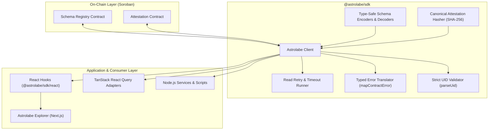

# @astrolabe/sdk

[](https://github.com/soroban-dev-tools/astrolabe-sdk/actions/workflows/ci.yml)
[](LICENSE)
[](https://www.typescriptlang.org/)

TypeScript client for **Astrolabe**, an open attestation registry on Stellar's Soroban smart contract platform. Read and create attestations in a few lines of code, with contract addresses vendored directly so you never hardcode them.

> **Status:** Prerelease (`0.1.0`), Testnet & Local Standalone, unaudited.

---

## Architecture

Astrolabe is designed as a modular 3-tier architecture:



---

## Installation

```bash
pnpm add @astrolabe/sdk
# or: npm install @astrolabe/sdk
# or: yarn add @astrolabe/sdk
```

React hooks and TanStack Query adapters are available from `@astrolabe/sdk/react`. `react` is an optional peer dependency.

---

## Quickstart

### 1. Read a Schema and Attestation (No Signer Required)

Pure reads require no private keys or wallet connections:

```ts
import { Astrolabe, deployments } from "@astrolabe/sdk";

// Initialize client for Testnet (default)
const astrolabe = new Astrolabe({ network: "testnet" });

// Read a vendored seed schema
const schemaUid = deployments.seedSchemas.verified_merchant;
const schema = await astrolabe.getSchema(schemaUid);
console.log("Schema:", schema?.name, schema?.definition);

// Check if an attestation is valid (exists, not revoked, not expired)
const isValid = await astrolabe.isValid("<attestation-uid-hex>");
console.log("Valid:", isValid);

// Read total attestations registered against a schema
const count = await astrolabe.schemaAttestationCount(schemaUid);
console.log("Total attestations:", count);
```

### 2. Type-Safe Schema Encoding & Compile-Time Inference

Astrolabe provides compile-time TypeScript type inference from schema definition strings:

```ts
import {
  encodeData,
  decodeTyped,
  createSchemaDecoder,
  type InferSchemaType,
} from "@astrolabe/sdk";

const definition = "string name,u32 score,bool active" as const;

// 1. Compile-time inferred type: { name: string; score: number; active: boolean }
type MemberRecord = InferSchemaType<typeof definition>;

// 2. Type-safe binary encoding
const encodedBytes = encodeData(definition, {
  name: "Alice",
  score: 100,
  active: true,
});

// 3. Type-safe binary decoding
const decoded = decodeTyped<typeof definition>(definition, encodedBytes);
console.log(decoded.name, decoded.score, decoded.active);

// 4. Reusable precompiled decoder
const decodeMember = createSchemaDecoder<MemberRecord>(definition);
const member = decodeMember(encodedBytes);
```

### 3. Creating & Revoking Attestations (With Signer)

In Node.js, initialize a signer from a secret key. In browser environments, delegate signing to a wallet (see [Browser Wallet Signing Guide](docs/wallet-signing.md)):

```ts
import {
  Astrolabe,
  deployments,
  encodeData,
  signerFromSecret,
} from "@astrolabe/sdk";

const signer = signerFromSecret(
  process.env.STELLAR_SECRET!,
  deployments.networkPassphrase,
);

const astrolabe = new Astrolabe({
  network: "testnet",
  publicKey: signer.publicKey,
  signTransaction: signer.signTransaction,
});

const schemaUid = deployments.seedSchemas.verified_merchant;
const schema = await astrolabe.getSchema(schemaUid);

// Encode payload matching schema definition
const data = encodeData(schema!.definition, { name: "Acme Corp", country: "NG" });

// Issue an on-chain attestation
const attestationUid = await astrolabe.attest({
  issuer: signer.publicKey,
  schemaUid,
  subject: signer.publicKey,
  data,
});
console.log("Created attestation UID:", attestationUid);

// Revoke attestation
await astrolabe.revoke(signer.publicKey, attestationUid);
console.log("Attestation revoked");
```

---

## Network Configuration

Astrolabe supports standard network presets and custom environment overrides:

### Testnet Preset (`network: "testnet"`, default)
- RPC: `https://soroban-testnet.stellar.org`
- Network Passphrase: `"Test SDF Network ; September 2015"`
- Contract IDs: Vendored in `src/deployments.json`

### Local Standalone Preset (`network: "local"`)
- RPC: `http://localhost:8000/soroban/rpc`
- Network Passphrase: `"Standalone Network ; February 2017"`
- Automatic `allowHttp: true`
- Automatically loads contract IDs from `CONSTELLATION_DEPLOYMENTS` environment variable (JSON string or file path) if present.

```ts
// Local standalone node setup
const localClient = new Astrolabe({
  network: "local",
});
```

### Custom Network Overrides
```ts
const customClient = new Astrolabe({
  rpcUrl: "https://my-custom-rpc.example.com",
  networkPassphrase: "My Custom Network",
  contractIds: {
    schema_registry: "CAAAAAAAAAAAAAAAAAAAAAAAAAAAAAAAAAAAAAAAAAAAAAAAAAAAAAAA",
    attestation: "CBAAAAAAAAAAAAAAAAAAAAAAAAAAAAAAAAAAAAAAAAAAAAAAAAAAAAAA",
  },
});
```

---

## Read Retry & Timeout Policy

Read methods (`getSchema`, `getAttestation`, `isValid`, `attestationsForSubject`, `schemaAttestationCount`) automatically retry transient network or RPC failures using exponential backoff:

```ts
const client = new Astrolabe({
  retry: {
    maxRetries: 3,        // Total 4 attempts (default: 2)
    delayMs: 250,         // Initial delay (default: 200ms)
    maxDelayMs: 3000,     // Cap on backoff delay (default: 2000ms)
    backoffFactor: 2,     // Multiplier per retry (default: 2)
    timeoutMs: 8000,      // Timeout per attempt in ms (default: 10000ms)
  },
});
```

> **Strict Write Safety:** Mutating write operations (`registerSchema`, `attest`, `revoke`) are strictly executed once and never automatically retried, avoiding duplicate transactions.

---

## Error Handling & Typed Errors

Soroban contract error codes are automatically translated into strongly typed error classes:

```ts
import {
  Astrolabe,
  SchemaNotFoundError,
  AttestationNotFoundError,
  NotAuthorizedToRevokeError,
  AlreadyRevokedError,
} from "@astrolabe/sdk";

try {
  await client.revoke(issuerAddress, attestationUid);
} catch (err) {
  if (err instanceof NotAuthorizedToRevokeError) {
    console.error("Signer is not authorized to revoke this attestation");
  } else if (err instanceof AlreadyRevokedError) {
    console.warn("Attestation was already revoked");
  } else if (err instanceof AttestationNotFoundError) {
    console.error("Attestation not found");
  } else {
    throw err;
  }
}
```

---

## React & TanStack Query Integration

Import hooks and query options from `@astrolabe/sdk/react`:

### Zero-Dependency React Hooks
```tsx
import { useAttestation, useIsValid, useSchema } from "@astrolabe/sdk/react";

function AttestationCard({ client, uid }: { client: Astrolabe; uid: string }) {
  const { data: attestation, loading, error, refetch } = useAttestation(client, uid);
  const { data: isValid } = useIsValid(client, uid);

  if (loading) return <div>Loading attestation...</div>;
  if (error) return <div>Error: {error.message}</div>;
  if (!attestation) return <div>Not found</div>;

  return (
    <div>
      <p>Subject: {attestation.subject}</p>
      <p>Valid: {isValid ? "Yes" : "No"}</p>
      <button onClick={refetch}>Refresh</button>
    </div>
  );
}
```

### TanStack React Query Adapters
Query option builders provide first-class compatibility with `@tanstack/react-query` v4 and v5 without adding hard dependencies to the SDK:

```tsx
import { useQuery, useQueryClient } from "@tanstack/react-query";
import {
  attestationQueryOptions,
  astrolabeQueryKeys,
} from "@astrolabe/sdk/react";

function AttestationView({ client, uid }: { client: Astrolabe; uid: string }) {
  const queryClient = useQueryClient();

  // 1. Consume standard query options
  const { data, isLoading } = useQuery(attestationQueryOptions(client, uid));

  // 2. Invalidate using deterministic query keys after writes
  const handleRevoke = async () => {
    await client.revoke(client.publicKey!, uid);
    queryClient.invalidateQueries({
      queryKey: astrolabeQueryKeys.attestation(uid),
    });
  };

  return <div>...</div>;
}
```

---

## Canonical Attestation Hashing (S6)

Compute deterministic SHA-256 digests for off-chain attestation verification and signing:

```ts
import {
  serializeAttestationPayload,
  hashAttestationPayload,
  hashAttestationPayloadHex,
} from "@astrolabe/sdk";

const payload = {
  schemaUid: "0123456789abcdef0123456789abcdef0123456789abcdef0123456789abcdef",
  issuer: "GBBBBBBBBBBBBBBBBBBBBBBBBBBBBBBBBBBBBBBBBBBBBBBBBBBBBBBB",
  subject: "GCCCCCCCCCCCCCCCCCCCCCCCCCCCCCCCCCCCCCCCCCCCCCCCCCCCCCCC",
  data: new Uint8Array([1, 2, 3, 4]),
  expiration: 1800000000n,
};

// Canonical length-prefixed bytes with domain separator ("astrolabe-attestation-v1")
const packed = serializeAttestationPayload(payload);

// 32-byte SHA-256 hash
const hashBytes = hashAttestationPayload(payload);

// 64-character hex hash string
const hashHex = hashAttestationPayloadHex(payload);
```

---

## Browser Wallet Signing

See the dedicated [Browser Wallet Signing Guide](docs/wallet-signing.md) for full examples with Freighter and Stellar Wallets Kit.

---

## Protocol Compatibility

| SDK version | Soroban Contract Protocol | Testnet | Local Standalone | Mainnet |
|-------------|----------------------------|---------|------------------|---------|
| 0.1.x       | v0.1.0                     | yes     | yes              | planned |

---

## Development

```bash
pnpm install
pnpm typecheck   # Type verification (tsc --noEmit)
pnpm lint        # ESLint verification
pnpm test        # Vitest unit test suite (91 passing tests)
pnpm build       # tsup build (ESM, CJS, DTS)
```

Integration tests require a funded Testnet secret key in `STELLAR_SECRET` (see `.env.example`).

---

## Contributing & Community

- [Contributing Guide](CONTRIBUTING.md)
- [Code of Conduct](CODE_OF_CONDUCT.md)
- [Security Policy](SECURITY.md)
- [Changelog](CHANGELOG.md)

---

## License

Apache-2.0. See [LICENSE](LICENSE) for details.
